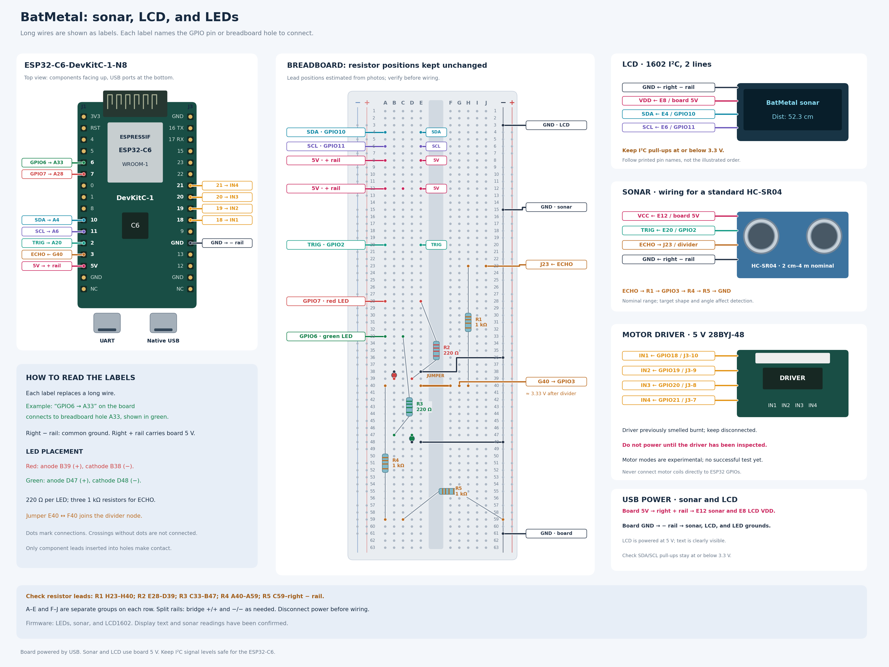

# Wiring: sonar, LCD, and LEDs



[SVG](wiring-esp32-c6.svg) · [PDF for zooming or printing](wiring-esp32-c6.pdf)

Long wires are represented by local labels. For example, “GPIO6 → A33” on the
board means connect that pin to breadboard hole A33. Module labels give their
breadboard holes. The electrical connections and resistor locations are listed
below.

Resistor positions are estimated from IMG_6452; check the actual holes before
wiring. The two resistors with red bands are 220 Ω; the other three are 1 kΩ.
Disconnect power while changing the wiring.

The LCD is marked **1602IIC**, has a 16×2 character display, and uses a
**PCF8574T** I²C backpack. It responds at I²C address 0x27. The display is now
powered from the board's 5 V pin and its text is clearly visible. No contrast
potentiometer is present; firmware cannot adjust the LCD's analog contrast.
Keep I²C signals within ESP32-C6 limits: the backpack's SDA/SCL pull-ups must
not drive the GPIO pins above 3.3 V when VDD is 5 V.

The sonar wiring assumes a standard 5 V HC-SR04; verify the model and follow its
printed pin names.

## Resistor positions

| Part | Estimated breadboard holes | Value | Purpose |
| --- | --- | --- | --- |
| R1, upper right | H23–H40 | 1 kΩ | ECHO series resistor to GPIO3 |
| R2, near the center groove | E28–D39 | 220 Ω | Red LED series resistor |
| R3, mid-left | C33–B47 | 220 Ω | Green LED series resistor |
| R4, lower left | A40–A59 | 1 kΩ | First ECHO divider resistor to ground |
| R5, horizontal at bottom | C59–right − rail | 1 kΩ | Second divider resistor to ground |

Do not reuse the previous wiring as-is. J23 is now the sonar ECHO connection;
do not connect it to GPIO6. GPIO3 is connected to the ECHO divider, not to an
LED.

## Board pins

| Signal | Board pin | Firmware state |
| --- | --- | --- |
| Green LED | GPIO6, J1 pin 5 | Startup test, then heartbeat |
| Red LED | GPIO7, J1 pin 6 | Startup test, then sonar error indicator |
| Motor IN1 | GPIO18, J3 pin 10 | Optional stepper modes |
| Motor IN2 | GPIO19, J3 pin 9 | Optional stepper modes |
| Motor IN3 | GPIO20, J3 pin 8 | Optional stepper modes |
| Motor IN4 | GPIO21, J3 pin 7 | Optional stepper modes |
| LCD SDA | GPIO10, J1 pin 10 | I²C scan and LCD1602 output |
| LCD SCL | GPIO11, J1 pin 11 | I²C scan and LCD1602 output |
| Sonar TRIG | GPIO2, J1 pin 12 | Bounded sonar acquisition |
| Sonar ECHO after divider | GPIO3, J1 pin 13 | Bounded sonar acquisition |
| Shared ground | GND, J3 pin 12 | Right − rail |

## LEDs

Each LED circuit is GPIO → 220 Ω resistor → LED anode → LED cathode → GND.
Do not connect the resistor directly from GPIO to GND in parallel with the LED.

| Connection | Breadboard position |
| --- | --- |
| GPIO7 | A28, same connected group as R2 at E28 |
| Red LED anode (+, long lead) | B39, same group as R2 at D39 |
| Red LED cathode (−, short lead / flat edge) | B38 |
| Red LED return | E38 to right − rail |
| GPIO6 | A33, same group as R3 at C33 |
| Green LED anode (+) | D47, same group as R3 at B47 |
| Green LED cathode (−) | D48 |
| Green LED return | E48 to right − rail |

Each LED's leads occupy consecutive rows. The red cathode is on row 38 to keep
row 40 available for the sonar divider. Move the green LED away from its old
position near row 40. Neither LED lead may connect to the ECHO node on row 40.

## Sonar and ECHO divider

For a standard HC-SR04, connect the board's **5V pin** (J1 pin 14) to the right
+ rail while the board is USB-powered. Connect GND to the common − rail and
TRIG to GPIO2.
**Never connect the 5 V ECHO output directly to GPIO3.**

```text
ECHO ── R1 1 kΩ ──●── R4 1 kΩ ── R5 1 kΩ ── GND
                  │
                GPIO3
```

R4 and R5 form 2 kΩ to GND. With 5 V ECHO, the nominal GPIO3 voltage is
`5 × 2 / (1 + 2) = 3.33 V`. Actual voltage depends on supply and resistor
tolerances; check levels if parts or power are uncertain.

| Connection | Breadboard position |
| --- | --- |
| Sonar VCC | Right + rail → E12 → sonar VCC |
| GPIO2 to TRIG | GPIO2 → A20; E20 → TRIG |
| Sonar ECHO | J23, same group as R1 at H23 |
| ECHO divider bridge | Jumper E40 ↔ F40 |
| GPIO3 | G40, same group as R1 H40 and F40 |
| Divider to GND | R4 A40–A59; R5 C59–right − rail |

Jumper E40–F40 connects the two halves of row 40. R4 and R5 connect through
the A–E group on row 59. Do not add +5 V to rows 40 or 59.

The HC-SR04's nominal range is **2 cm to 4 m**, with a roughly 15° measurement
angle. The firmware accepts 20–4000 mm and waits up to 30 ms for an echo.
Real-world range and accuracy depend on the target's size, angle, surface, and
the surrounding environment. The HC-SR04 datasheet recommends a measurement
cycle longer than 60 ms to reduce interference between echoes ([datasheet](https://cdn.sparkfun.com/datasheets/Sensors/Proximity/HCSR04.pdf)).
The firmware enforces a minimum 65 ms between triggers; echo and LCD update
time lower the actual rate. In normal mode, samples are emitted as JSON lines;
invalid readings have a `null` distance and an error code.

## LCD1602 I²C wiring

| LCD pin | Proposed connection |
| --- | --- |
| GND | Right − rail |
| VDD | Right + rail → E8 → LCD VDD (working setup) |
| SDA | GPIO10 → A4; E4 → LCD SDA |
| SCL | GPIO11 → A6; E6 → LCD SCL |

The display is powered from 5 V and text is clearly readable. The PCF8574T
backpack responds at 0x27. Ensure its SDA/SCL pull-ups do not drive GPIO10/GPIO11
above 3.3 V; use level shifting if the backpack pulls these lines up to 5 V.
Keep grounds common.

## Power rails and stepper hardware

The board is powered by USB. Connect its 5 V pin to the right + rail, then
connect E12 to sonar VCC and E8 to LCD VDD. Confirm that the + rail is continuous
or bridge its split sections. The right − rail is common ground for board,
sonar, LCD, and LEDs.

The 28BYJ-48 motor plugs into the driver's white five-wire socket. Its board
shows IN1–IN4, with IN5–IN7 unused. The first motor test through the pictured
driver produced a burnt smell and no movement. **Do not reconnect or power that
driver until it has been inspected and replaced if damaged.** Never power the
motor coils from an ESP32 GPIO or 3V3 pin. Use a suitable 5 V motor supply and
a common ground when the driver is confirmed safe. The optional motor firmware
modes currently use GPIO18/19/20/21 for IN1/IN2/IN3/IN4; the default firmware
does not drive them.

The stepper test mode waits ten seconds, commands 64 half-steps out and back,
then releases the coils. The scan mode is experimental open-loop control: a
single nominal 0–180° sweep in 128-half-step increments (about 11.25°), with
sonar measurements after each movement. JSON records contain `sample`, `step`,
`angle_mdeg`, and `distance_mm` (`null` when the sonar measurement fails). The
motor modes disable LCD communication. Step counts estimate angle only; they do
not detect missed steps or home the motor. The motor test has not passed.

## Manual mapping and limitations

For a fixed-point scan, keep the sonar at a constant height on a support that
pivots around one fixed point. A cardboard protractor and pointer can provide
manual angles. Record several distance samples at each angle and retain the
median of valid readings. The firmware streams distance samples; collecting
known angles and rendering a map are still manual steps.

A scan from one fixed point shows an approximate view of obstacles. Combining
scans from different locations also requires each sensor position and heading
in a shared coordinate frame. Hand movement without reference marks does not
provide those data.

## Breadboard notes and references

On each row, A–E are connected and F–J are a separate group, divided by the
center groove. Only inserted component leads make contact. Dots in the drawing
mark electrical junctions; a crossing without a dot is not connected.

The power rails are not numbered like the A–J groups. Use the printed +/− marks
and free holes. Check rail continuity and bridge the two rail halves separately
(+/+ and −/−) if needed.

The default firmware tests the LEDs, measures sonar distance, scans I²C, and
updates the LCD1602 in centimeters. The PCF8574T responds at address 0x27. The
screen has been visually confirmed, with VDD supplied at 5 V. Firmware
build success and I²C acknowledgement alone cannot verify all physical behavior.

References: [official DevKitC-1 pinout](https://docs.espressif.com/projects/esp-dev-kits/en/latest/esp32c6/esp32-c6-devkitc-1/user_guide.html),
[HC-SR04 5 V sensor](https://www.sparkfun.com/ultrasonic-distance-sensor-hc-sr04.html),
[ESP32-C6 electrical levels](https://documentation.espressif.com/esp32-c6_datasheet_en.html).
